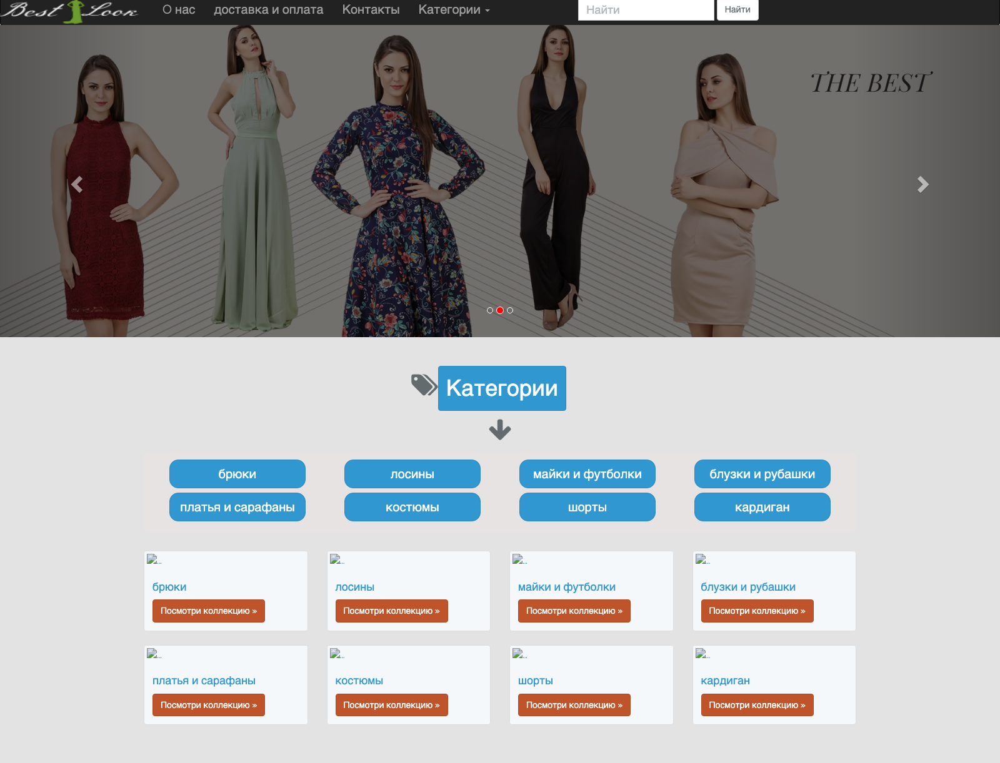
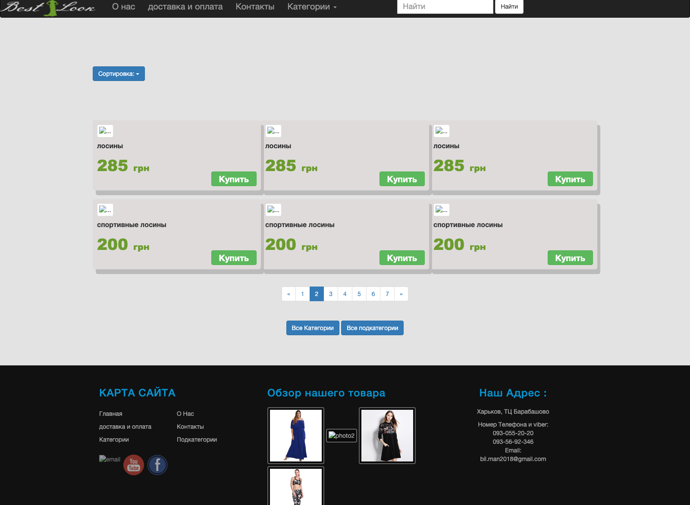

# Internet Magazine

A Laravel (PHP) magazine / e-commerce style website with a Voyager admin panel, category & item browsing, ordering pages, contact form and mail sending.

## Website

### The live site — preserved in the Internet Archive (January 2018)

`best-look.net` is no longer this shop, but the Wayback Machine kept **25 captures** of it (13 Feb 2004 – 14 Jan 2025), including the pages, CSS, JS and photos of this exact Laravel build.





| Archived page | Snapshot |
|---|---|
| Homepage (hero slider + categories) | <https://web.archive.org/web/20180128062249/http://www.best-look.net/> |
| Items of category 2 (page 2 of 7) | <https://web.archive.org/web/20180129105036/http://www.best-look.net/categories/2/items?page=2> |
| Categories index | <https://web.archive.org/web/20180129105005/http://www.best-look.net/categories> |
| News | <https://web.archive.org/web/20180129104955/http://www.best-look.net/news> |
| Services / delivery & payment | <https://web.archive.org/web/20180129105000/http://www.best-look.net/service> |
| Contact | <https://web.archive.org/web/20180129104950/http://www.best-look.net/contact> |
| All captures of the domain | <https://web.archive.org/web/*/best-look.net> |

From those snapshots: shop located in **Kharkiv, TC Barabashovo**, phones/viber `093-055-20-20`, `093-56-92-346`, email `bil.man2018@gmail.com`, copyright 2017 Dahlab Mansour Inc. Prices were in hryvnia (e.g. лосины 285 грн, спортивные лосины 200 грн), and category 2 had 7 pages of items.

> Note: the captures from **2004** are a different, unrelated site on the same domain, and the **2024–2025** captures are an unrelated "Bestlook" streetwear store in Barcelona — the domain was re-registered after this project.

### Running it locally today


**Main page:** <http://localhost:8004/> (Docker container `bestlook`, PHP 7.4 + MySQL)

| Page | URL |
|---|---|
| Home / hero slider + category grid | `/` |
| Categories | `/categories` |
| Items of a category | `/categories/{id}/items` |
| Item details & order form | `/categories/{cat_id}/items/{id}` |
| News | `/news` |
| Services | `/service` |
| Contact | `/contact` |
| Voyager admin panel | `/admin` |

The local screenshot was captured with headless Chrome. The Font Awesome icons show as empty boxes because the CSS resolves them to `/fonts/…`, while the font files actually live in `assets/fonts/`.


## Stack

- **Laravel 5.4** (`internet-magazine/`)
- **Voyager** `^0.11.14` — admin CMS at `/admin`
- **Laravel Scout + Algolia** — search
- **laravelcollective/html**, **5dmatwebsearch/advancesearch**
- **MySQL / MariaDB** — schema dump included as `magazine (1).sql`

## Repository layout

```
.
├── internet-magazine/     # Laravel application
│   ├── app/               # Models, controllers, mail, providers
│   ├── resources/views/   # Blade templates
│   ├── public/            # css, js, images, assets
│   ├── routes/web.php     # Public + Voyager admin routes
│   └── storage/app/public/# Uploaded images (categories, items, posts...)
├── screenshots/           # Homepage screenshot of the running site
├── website-photos/        # Photos scraped from the site
├── magazine (1).sql       # phpMyAdmin export of the `magazine` database
└── README.md
```

## Setup

```bash
cd internet-magazine
composer install
cp .env.example .env
php artisan key:generate
```

Create the database and import the dump:

```bash
mysql -u root -e "CREATE DATABASE IF NOT EXISTS \`internet-magazin\` CHARACTER SET utf8mb4;"
mysql -u root internet-magazin < "../magazine (1).sql"
php artisan migrate
php artisan serve   # http://localhost:8000  (admin: /admin)
```

## Notes

- `.env` is **not** committed (it contains local DB and Mailtrap credentials); use `.env.example` as the template.
- `vendor/`, `node_modules/`, editor files and Laravel cache/log folders are ignored by git.
