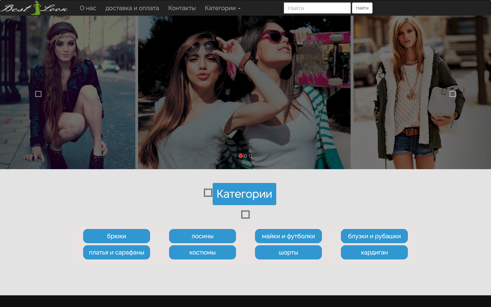

# Internet Magazine

A Laravel (PHP) magazine / e-commerce style website with a Voyager admin panel, category & item browsing, ordering pages, contact form and mail sending.

## Website — main page



**Main page:** <http://localhost:8004/> (running locally in Docker, container `bestlook`, PHP 7.4 + MySQL)

| Page | URL |
|---|---|
| Home / hero slider + category grid | `/` |
| Categories | `/categories` |
| Items of a category | `/categories/{id}/items` |
| Item details & order form | `/categories/{cat_id}/items/{id}` |
| News | `/news` |
| Services | `/service` |
| Contact | `/contact` |
| Voyager admin panel | `/admin` |

The screenshot was captured with headless Chrome against the locally running app. The Font Awesome icons show as empty boxes because the CSS resolves them to `/fonts/…`, while the font files actually live in `assets/fonts/`.


## Stack

- **Laravel 5.4** (`internet-magazine/`)
- **Voyager** `^0.11.14` — admin CMS at `/admin`
- **Laravel Scout + Algolia** — search
- **laravelcollective/html**, **5dmatwebsearch/advancesearch**
- **MySQL / MariaDB** — schema dump included as `magazine (1).sql`

## Repository layout

```
.
├── internet-magazine/     # Laravel application
│   ├── app/               # Models, controllers, mail, providers
│   ├── resources/views/   # Blade templates
│   ├── public/            # css, js, images, assets
│   ├── routes/web.php     # Public + Voyager admin routes
│   └── storage/app/public/# Uploaded images (categories, items, posts...)
├── screenshots/           # Homepage screenshot of the running site
├── website-photos/        # Photos scraped from the site
├── magazine (1).sql       # phpMyAdmin export of the `magazine` database
└── README.md
```

## Setup

```bash
cd internet-magazine
composer install
cp .env.example .env
php artisan key:generate
```

Create the database and import the dump:

```bash
mysql -u root -e "CREATE DATABASE IF NOT EXISTS \`internet-magazin\` CHARACTER SET utf8mb4;"
mysql -u root internet-magazin < "../magazine (1).sql"
php artisan migrate
php artisan serve   # http://localhost:8000  (admin: /admin)
```

## Notes

- `.env` is **not** committed (it contains local DB and Mailtrap credentials); use `.env.example` as the template.
- `vendor/`, `node_modules/`, editor files and Laravel cache/log folders are ignored by git.
